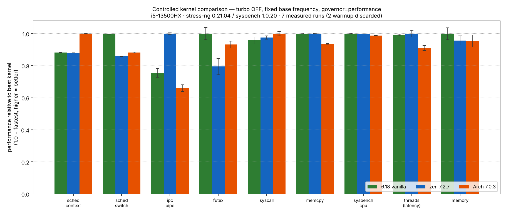
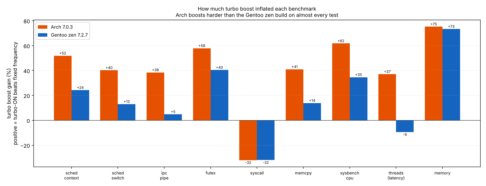
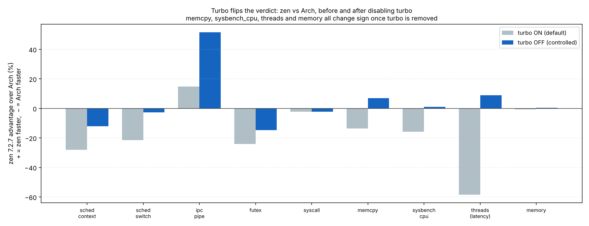

# kbench — a controlled Linux kernel micro-benchmark on one laptop

**Three kernels, one machine, nine kernel-level micro-benchmarks, two power regimes.**
A small study of how much of a "kernel A is faster than kernel B" result is really
the kernel — and how much is just turbo boost.

Hardware: Acer Predator Helios Neo 16 (PHN16-71) · Intel Core i5-13500HX
(14C/20T, Raptor Lake) · 16 GB DDR5 · dual-boot Arch / Gentoo.

---

## TL;DR

- Naively comparing a stock Arch kernel against a hand-built Gentoo `zen` kernel
  with turbo boost left on makes Arch look **19–39 % faster** across most tests.
- Disabling turbo and pinning the CPU to its base frequency **erases most of that
  gap and flips the verdict on four of nine tests.** The "win" was largely a
  difference in *boost behaviour*, not in the kernels.
- With turbo removed, no kernel wins outright. Each is faster at a *different class*
  of work:
  - **Gentoo `zen` 7.2.7** dominates pipe IPC (**+32 %**) and ties on compute.
  - **Gentoo vanilla 6.18** leads context-switch, futex and memory bandwidth.
  - **Stock Arch 7.0.3** leads the raw scheduler-context and syscall micro-tests.
- `-march=native` shows up cleanly in `memcpy`: both Gentoo builds beat the
  generic Arch build by ~7 %, independent of kernel version.



---

## 1. Motivation

"I built a custom kernel, is it faster?" is easy to ask and easy to answer badly.
A laptop CPU spends most of a benchmark deciding how hard to boost, so two kernels
can post very different numbers for reasons that have nothing to do with the kernel.
This project measures the kernel-owned parts of the system (the scheduler, context
switching, IPC, syscalls, synchronisation, memory) and then **controls the one
variable that usually dominates laptop benchmarks: turbo boost.**

## 2. Kernels under test

| label | kernel | source / tuning | compiler |
|-------|--------|-----------------|----------|
| **Arch 7.0.3** | `7.0.3-arch1-2` | distro stock `linux`, generic `-O2` | gcc 16.1.1 |
| **zen 7.2.7** | `7.2.7-zen1` | Gentoo `zen-sources`, `-march=native -O2`, `ZEN_INTERACTIVE`, trimmed config | gcc 15.2.1 |
| **6.18 vanilla** | `6.18.35-gentoo-r1` | Gentoo `gentoo-sources`, `-march=native -O2`, hand-rolled config | gcc 15.2.1 |

All three run the **same userspace binaries' versions**: stress-ng 0.21.04,
sysbench 1.0.20. Kernel configs are in [`configs/`](configs/).

## 3. Benchmarks (kernel-centric)

| test | tool | what it stresses |
|------|------|------------------|
| `sched_context` | stress-ng | context-switch throughput |
| `sched_switch` | stress-ng | scheduler switch rate |
| `ipc_pipe` | stress-ng | pipe IPC throughput |
| `futex` | stress-ng | futex / synchronisation |
| `syscall` | stress-ng | syscall entry/exit overhead |
| `memcpy` | stress-ng | memory copy (sensitive to `-march`) |
| `sysbench_cpu` | sysbench | prime compute (frequency-bound control) |
| `sysbench_threads` | sysbench | thread scheduling **latency** (lower = better) |
| `sysbench_memory` | sysbench | memory bandwidth |

Pure userspace throughput (e.g. `openssl speed`) is deliberately excluded: it would
mostly measure the three different libc/toolchain builds, not the kernel.

## 4. Methodology

Everything is driven by [`kbench.sh`](kbench.sh). For every test:

- **governor → `performance`** on all 20 logical CPUs (restored on exit).
- **2 warm-up iterations discarded, then 7 measured** — warm-up absorbs the
  turbo transient on a cold CPU, which otherwise inflates the first runs.
- **cool-down between every iteration** to a package-temperature target, read
  from `coretemp` via `lm_sensors`, so each run starts from an equal thermal state.
- **median + sample stddev + min/max** over the 7 measured runs. Median is robust;
  stddev reports spread. A one-off mis-parsed stress-ng row is rejected by an
  outlier guard (>10× the running median).
- Run from a **bare TTY** (no desktop/compositor) on every kernel.

The **controlled (`-ctl`) regime** adds:
- **turbo boost disabled** (`intel_pstate/no_turbo`), so the CPU is pinned to its
  base frequency and the comparison is clock-for-clock;
- cool target 50 °C, 10 s runs, and the **package temperature logged after each
  run** (the `dT` in the logs) to confirm no in-run thermal throttling
  (observed dT ≤ +11 °C, nowhere near the ~100 °C throttle point).

Raw per-run numbers, environment capture and full transcripts are in
[`results/`](results/) (`*.csv`, `*.env`, `*.log`).

## 5. Results

### 5.1 Controlled — turbo off, clock-for-clock

Median of 7 runs. **Bold** = fastest for that test. Relative σ was ≤ 4 % on every
cell and < 1 % on most (turbo-off makes the machine extremely repeatable).

| test | unit | 6.18 vanilla | zen 7.2.7 | Arch 7.0.3 | winner (margin) |
|------|------|---:|---:|---:|---|
| sched_context | bogo-ops/s ↑ | 52,782 | 52,674 | **59,866** | Arch (+13 %) |
| sched_switch | bogo-ops/s ↑ | **5,197,917** | 4,466,560 | 4,588,882 | 6.18 (+13 %) |
| ipc_pipe | bogo-ops/s ↑ | 10,856,546 | **14,374,799** | 9,488,391 | zen (+32 %) |
| futex | bogo-ops/s ↑ | **1,061,703** | 843,919 | 989,263 | 6.18 (+7 %) |
| syscall | bogo-ops/s ↑ | 959 | 977 | **1,001** | Arch (+2 %) |
| memcpy | bogo-ops/s ↑ | **3,059** | 3,058 | 2,863 | Gentoo ×2 (+7 % vs Arch) |
| sysbench_cpu | events/s ↑ | **9,900** | 9,886 | 9,783 | tie (+0–1 %) |
| sysbench_threads | ms latency ↓ | 2.35 | **2.33** | 2.56 | Gentoo ×2 (−9 % vs Arch) |
| sysbench_memory | MiB/s ↑ | **79,415** | 76,042 | 75,755 | 6.18 (+4 %) |

No kernel wins across the board. The spread of winners is the result.

### 5.2 The turbo effect

With turbo **on**, the same hardware reports 38–75 % higher throughput on most
tests — and Arch boosts harder than the Gentoo zen build almost everywhere.



### 5.3 Turbo flips the verdict

The headline comparison (zen vs Arch) changes sign on **four of nine tests** once
turbo is removed. `sysbench_threads` swings from Arch **+58 %** ahead to zen
**+9 %** ahead; `memcpy` and `sysbench_cpu` likewise flip to Gentoo.



## 6. Analysis

**1. Most of the "stock Arch is faster" story was turbo, not the kernel.**
At a fixed base clock the kernels are within a few percent on compute and memory,
and the large gaps collapse (`sched_switch` from +22 % to +3 %; `sched_context`
from +39 % to +13 %).

**2. `zen`'s tuning is a trade-off, visible in one controlled build family.**
Comparing `zen` 7.2.7 against vanilla 6.18 — *same distro, same `-march=native`,
same gcc 15.2.1, both turbo-off* — isolates the effect of the zen patch set plus
the version bump. `zen` **loses** `sched_switch` (−14 %) and `futex` (−20 %) but
**wins** `ipc_pipe` (+32 %). That is consistent with a desktop-latency tuning that
spends scheduler/synchronisation throughput to gain elsewhere, rather than being
"faster" or "slower" overall.

**3. `-march=native` earns its keep in memory copy.** Both Gentoo builds (3,058–3,059)
beat generic Arch (2,863) in `memcpy` by ~7 %, and the two Gentoo builds are
identical to each other — so the gain tracks the build flags, not the kernel version.

**4. A counter-intuitive but repeatable syscall inversion.** On all kernels `syscall`
throughput is *higher* with turbo off (~1000 vs ~665–680). Under a 20-thread load,
per-core turbo frequency jitter appears to hurt a tight, uniform syscall stream more
than the lower-but-steady base clock does.

**5. Thermals, as a side observation.** The Gentoo builds idle/recover cooler than
stock Arch, and 6.18 would not drop below ~53 °C at idle where 7.2/Arch reach 50 °C
(see Limitations). On this chassis the EC fan curve and hardware thermal throttle
keep the CPU well inside spec regardless of distro.

## 7. Limitations & threats to validity

Stated plainly, because they bound the conclusions:

- **Compiler is not held constant.** Arch is built with gcc 16.1.1, both Gentoo
  kernels with gcc 15.2.1. Part of any Arch-vs-Gentoo difference may be the newer
  compiler, which `-march=native` does not cancel. The *6.18-vs-zen* comparison,
  however, holds the compiler fixed and is the cleaner one.
- **Kernel version is confounded with tuning** in the Arch-vs-zen pair (7.0.3 vs
  7.2.7). The 6.18-vs-zen pair controls for distro/flags but still spans 6.18→7.2.
- **One machine, one chassis.** No claim generalises beyond this i5-13500HX laptop.
- **Idle-floor asymmetry.** 6.18 could not reach the 50 °C cool target (idle floor
  ~53 °C); its `-ctl` iterations start ~3 °C warmer. With turbo off the frequency is
  fixed, so the effect on throughput is negligible, but it is a real asymmetry.
- **No default (turbo-on) run for 6.18** — the turbo-effect analysis is shown only
  for the two kernels where both regimes were measured (Arch, zen).
- bogo-ops are stress-ng's internal unit, meaningful for *relative* comparison on
  identical binaries, not as an absolute figure of merit.

## 8. Reproduce

```bash
# deps (Arch example)
sudo pacman -S stress-ng sysbench lm_sensors cpupower
sudo sensors-detect --auto

# from a bare TTY, as root:
./kbench.sh <label>            # default regime (turbo on)
# controlled regime: the script disables turbo and tightens thermals itself
# (see DISABLE_TURBO / COOL_TARGET at the top of kbench.sh)

# analysis + figures
python3 analyze.py            # writes analysis/
python3 plot.py               # writes figures/
```

## 9. Repository layout

```
kbench.sh               benchmark runner (governor, warmup-discard, cooldown,
                        turbo control, outlier guard, CSV/MD/ENV/LOG output)
analyze.py              computes the matrices and turbo-effect tables
plot.py                 renders the three figures
results/                per-kernel raw data: *.csv (+ *.env, *.log where kept)
configs/                the three kernel .config files
analysis/               computed summary.md + derived CSVs
figures/                fig1 controlled 3-way, fig2 turbo effect, fig3 flips
```

## 10. What I'd do next

- Hold gcc constant (rebuild Arch's kernel under gcc 15, or all three under 16) to
  separate compiler from kernel.
- Add a `zen`-debloated build (drop tracing/debug from the config) to test whether
  the `sched_switch`/`futex` cost is `ZEN_INTERACTIVE` by design or removable blot.
- Pin IRQs and isolate CPUs for the latency tests; add `schbench`/`cyclictest` for a
  proper tail-latency view, where a desktop-tuned kernel should actually shine.

---

*Benchmarks and analysis by Leo Skachkov. Tooling and write-up assisted. Data is
raw and included; corrections welcome.*
